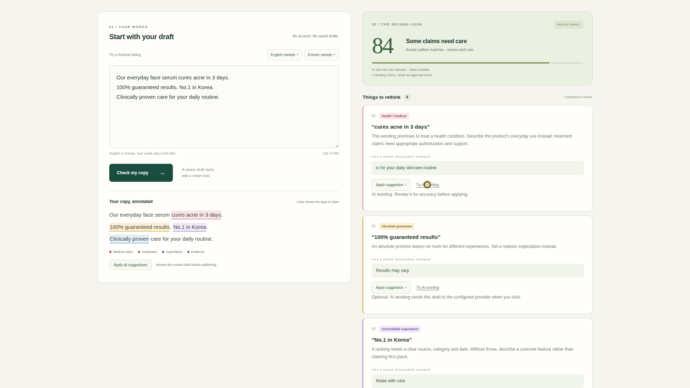
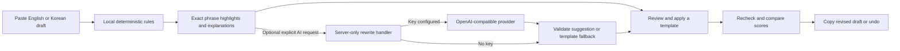

# Honest Copy

An explainable second look at product copy: spot risky English and Korean claims, understand why, and review more measured wording.



**For:** small online sellers in Korea and abroad who write their own listings, often late at night.

**Problem:** phrases such as “cures acne,” “100% guaranteed” and “No.1 in Korea” can overpromise or imply evidence the seller has not supplied. Sellers need help identifying the exact words worth reviewing.

**Solution:** paste copy, see four labeled highlight types, read plain explanations, apply individual or all local suggestions, and compare the before/after rule-risk indicator. Undo and copy the revised draft. English UI; English and Korean pattern sets. No accounts, database or saved drafts.

## Try it / demo

- Live application: **https://honest-copy.vercel.app**.
- Real-screen demonstration: [75-second 1080p MP4](media/demo.mp4) (about 1.1 MB, recorded on pilot).
- Fresh 1920×1080 live AI screenshots: [English review](media/english-review.png), [revised draft](media/english-revised.png), [Korean review](media/korean-review.png), [Korean revision](media/korean-revised.png). [Mobile](media/mobile-review.png) retains the original local-template capture.

The original recording shows the actual app in labeled local template mode before a provider key was configured. It has no voiceover or third-party media. The Korean fictional sample means: “This serum treats acne. Effect 100% guaranteed. No.1 domestically. A clinically proven daily-care product.” Its measured rewrite describes everyday care and notes that individual experiences can vary.

The [official submission rules](https://learn-ai-basics.devpost.com/rules) require uploading the video publicly to YouTube or Vimeo. The MP4 in this repository is ready for that owner account step; a GitHub video file is not presented as satisfying the required hosted-video link.

## How it works



Rules: [src/rules.mjs](src/rules.mjs). UI: [src/main.ts](src/main.ts). Provider boundary: [server/rewrite.mjs](server/rewrite.mjs), shared by Vite and the Vercel API adapter.

The score is `min(100, sum of matched weights)`: medical 28, guarantees 22, superlatives 18, implied evidence 16. Lower means fewer matched patterns. **Zero does not mean compliant, truthful, safe, or approved.** This is a finite wording heuristic, not legal advice, evidence verification or a platform-policy classifier. Negation and context can produce false positives; unlisted claims can be missed. Review every replacement for grammar and accuracy.

Evidence-related wording remains flagged even if a draft mentions a study, because this app cannot verify it. [FTC health-products guidance](https://www.ftc.gov/business-guidance/resources/health-products-compliance-guidance) is useful background on substantiation. Rules are original heuristics, not a transcription of that guidance or a Korean legal rule set.

## Run and test

Use Node **22.12+**.

```sh
npm install
npm run dev
# Open http://localhost:5173
npm test
npm run build
npm run preview
# Open http://localhost:4173
```

Checks use the built-in Node runner; no test framework or API key is required. CI runs tests, TypeScript checks and a production build on every push/PR.

On this project's low-memory Mac/server setup, installs, builds and browser work run on Ubuntu `pilot`. For browser verification/capture, reuse Playwright with `PLAYWRIGHT_MODULE=/absolute/path/to/playwright/index.mjs` and optionally `CHROMIUM_PATH=/absolute/path/to/chrome`. `APP_URL` selects a different app URL. `npm run capture` includes local API mode and explicitly mocked AI transport; neither is a claim that a real provider call succeeded. On pilot, `node scripts/record.mjs` records production at 1920×1080 with smooth typing, asserts live provider results, and uses ffmpeg to save English/Korean review and apply clips plus a continuous review-to-apply hook in `VIDEO_DIR` (default `media`). It also refreshes screenshots and prints panel coordinates for video zooms. Generated clips are ignored by git; the small screenshots are committed.

## Optional AI wording

Copy `.env.example` to `.env` and set server-only values, then restart Vite:

| Variable | Empty-value behavior |
| --- | --- |
| `LLM_API_KEY` | No provider call; real deterministic templates |
| `LLM_BASE_URL` | `https://api.tokenfactory.nebius.com/v1/` |
| `LLM_MODEL` | `nvidia/Nemotron-3_5-Lightning` |

The base and model follow the [official Nebius quickstart](https://docs.tokenfactory.nebius.com/quickstart) and [JSON-mode reference](https://docs.tokenfactory.nebius.com/ai-models-inference/json). Other OpenAI-compatible providers can be configured through the same variables. The server calls `POST chat/completions` in JSON mode with a 256-token output budget; Nebius requests disable thinking with `chat_template_kwargs.enable_thinking=false` and a `/no_think` instruction. English/Korean examples and explicit text before/after the selection guide subject agreement, particles and sentence endings. The prompt removes unsupported promises rather than replacing them with invented benefits or manufacturing claims. It reads only `choices[0].message.content`, strips any `<think>` blocks, and extracts JSON `{ "replacement": "..." }` even when wrapped in Markdown or short prose. Reasoning-only, truncated, malformed, wrong-language, unsafe or timed-out replies visibly fall back to local templates. Provider requests time out after 25 seconds; the browser allows 30 seconds. The mode switches automatically when the key exists. Numeric provider usage is returned for verification, without reasoning or raw provider metadata.

### Live mode

Production uses server-only `LLM_BASE_URL`, `LLM_API_KEY`, and `LLM_MODEL` in Vercel. The public UI exposes availability only; **Try AI wording** makes the optional live request. Run `LIVE_CAPTURE=1 APP_URL=https://honest-copy.vercel.app npm run capture` on pilot to verify real English/Korean suggestions and capture 1920×1080 screenshots. This mode asserts `mode: live`; it never mocks provider responses.

Verified on the production URL on October 16, 2026: `node scripts/eval-live.mjs` passed four real English/Korean medical and guarantee rewrites, each in 0.69–1.40 seconds. Examples: “Our everyday face serum is for your daily skincare routine.” and “이 세럼은 일상적인 피부 관리에 사용하는 제품입니다.” Guarantee wording became “Results may vary” and “사용감은 개인에 따라 다를 수 있습니다”. All four returned `mode: live`, used 2,295 total provider tokens and lowered the rule-risk score. The script checks language, length, numbers, unsupported claim patterns and duplicate endings; semantic grounding and fluency still require reading the sentences. Tests cover honest fallback independently; 33 tests and the production build passed.

Keys are never put in `VITE_` variables or browser code. AI requests send the draft to the configured provider only after the user clicks **Try AI wording**. The app has no analytics or copy storage. Basic per-instance request throttling and limits are for this PoC; stronger abuse controls are needed before exposing a funded API widely. Provider charges and limits depend on the owner's account; no services were purchased for this project.

## Deploy

```sh
vercel --prod --yes
```

Vercel hosts the static Vite build and `api/rewrite.mjs`. Optional secrets belong in the deployment's server environment. Static hosting can serve the complete local-template experience, but cannot provide live AI without a server handler. No key is needed for the public demo.

## How it uses the Devpost Learn Skill Pack

This new project began in an empty folder on October 16, 2026, during the stated hackathon submission period. Git was initialized, then the exact required command was run:

```sh
npx skills add challengepost/learn-ai-basics --all -y
```

The six installed skills were read and applied in order, using the owner's supplied IDEA ANSWERS as the interview input. Planning preceded app code in git history:

1. `1-start`: local ignored learner profile.
2. `2-scope`: [devpost/scope.md](devpost/scope.md).
3. `3-prd`: [devpost/prd.md](devpost/prd.md).
4. `4-spec`: [devpost/spec.md](devpost/spec.md).
5. `5-build`: [devpost/checklist.md](devpost/checklist.md), verified incremental commits, [offline app map](devpost/app-map.html).
6. `6-ship`: repository/privacy audit, accessible demo and deployment, remaining owner-only submission steps recorded in the spec.

The owner expressly required autonomous work without questions. Approval was delegated through that instruction; agent assumptions are labeled in the docs. Agent tests do not stand in for human hands-on feedback, personal reflection or learner sign-off: those remain explicitly unclaimed in the checklist. No Devpost submission or signup was performed. The current ship skill reserves final submission prose and survey answers for the learner.

## What was built during the hackathon

All application code, original bilingual patterns/templates, UI, tests, server adapter, CI, planning artifacts, app map and demo captures were created for this project. No old application code, scraped listings, third-party media or third-party logos were used. The official required skill pack is retained with its upstream MIT notice in `.agents/skills/LICENSE`; installer-created skill locations and links are preserved.

## What I wanted to learn / planning evidence

The owner's supplied learning goal: “planning before building with an AI agent, keeping decisions in docs so the AI doesn't forget.” The concrete practice demonstrated here is an observable requirement → a named implementation → a test. For example, the PRD's exact-phrase rewrite behavior maps to `applyFinding` and the repeated-phrase/Unicode tests. This is evidence of the workflow used, not an invented account of what the owner personally learned. The owner can add their reflection after trying the app.

## License

Original project code: MIT — Copyright (c) 2026 Kyoungsoo Kim. See [LICENSE](LICENSE). Required upstream curriculum retains its separate attribution.
