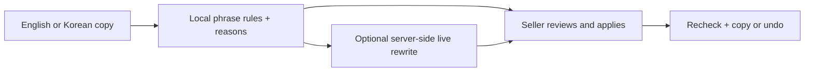

# Honest Copy

A second look at product copy for small online sellers, in English and Korean.

- Highlight medical promises, absolute guarantees, unsupported rankings and evidence claims.
- Read the reason and request a live rewrite; apply, undo and copy the wording you choose.
- Compare matched wording before and after. A lower score is not factual verification or publishing approval.

**Try it:** [honest-copy.vercel.app](https://honest-copy.vercel.app) · [Demo video (small preview)](media/demo.mp4)

## Quick start

Use Node 22.12+.

```sh
npm ci
npm run dev
npm test
npm run build
```

Open http://localhost:5173. With no API key, the app clearly labels its local template mode. For live AI, copy `.env.example` to `.env` and set server-only `LLM_API_KEY`; optional `LLM_BASE_URL` and `LLM_MODEL` select an OpenAI-compatible provider. Never use browser-exposed variables for keys.



## Sponsor technology and planning

- The **Devpost Learn Skill Pack** guided planning before code: [scope.md](devpost/scope.md), [prd.md](devpost/prd.md), [spec.md](devpost/spec.md). The [checklist](devpost/checklist.md) and [app map](devpost/app-map.html) connect the plan to the build. Owner reflection and Devpost submission remain owner steps.
- Live wording uses **NVIDIA Nemotron via Nebius Token Factory**, through a server-only OpenAI-compatible client. Defaults follow the [Nebius quickstart](https://docs.tokenfactory.nebius.com/quickstart). No key, unavailable output or failed validation produces an explicitly labeled local fallback.
- Checks run locally; only clicking **Try AI wording** sends the draft to the provider. No app accounts, saved drafts or analytics. Rules can miss claims and context; review the draft and its supporting evidence before publishing.

## Verification

`npm test` runs the Node tests. CI also checks TypeScript and the production build. On pilot, `scripts/record.mjs` checks three production listings through real browser actions, requires live AI for every phrase, saves full outputs, and records 1080p footage. Set `PLAYWRIGHT_MODULE`, `VIDEO_DIR` and `SAMPLES_DIR` to existing local paths; `APP_URL` defaults to production. The video uses real production results; its opening rejection stamp is an illustration, not a platform decision.

## What was built during the hackathon

The app, original bilingual rules, live rewrite handler, tests, CI, planning documents and demo were built for this project. No scraped listings or third-party media. The required skill pack keeps its upstream attribution. The demo MP4 still needs the owner's public YouTube/Vimeo upload for submission; no Devpost submission was made.

## License

MIT — Copyright (c) 2026 Kyoungsoo Kim. See [LICENSE](LICENSE). The upstream curriculum retains its separate notice.
