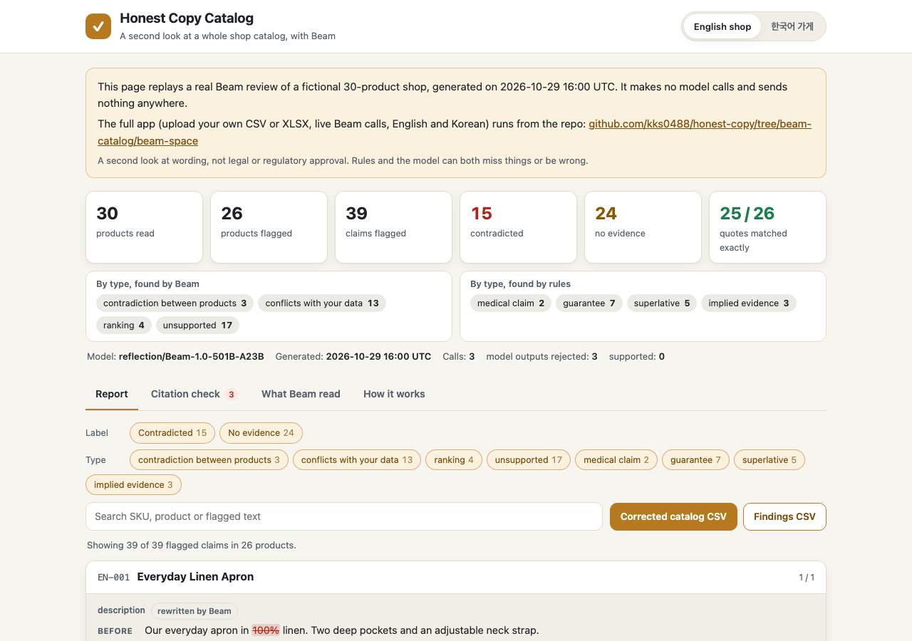
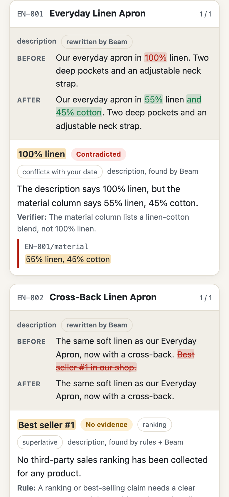

# Honest Copy Catalog (replay)

Small online shops write hundreds of product listings, often copied between similar items, and the copy drifts: one apron says 100% linen while the material column says a linen and cotton blend, several items each claim to be the #1 best seller, a cream says "clinically proven" when the only report on file is a 20-person comfort survey.

Honest Copy Catalog gives a whole catalog a second look with [Beam](https://huggingface.co/reflection/Beam-1.0-501B-A23B). This page replays a real Beam review of two fictional 30-product shops, one in English and one in Korean. It makes no model calls: it reads the saved result in `data/` and shows it.



## What you can see

- **Summary:** products read, claims flagged by label (contradicted, no evidence, supported) and by type, how many of Beam's quotes matched the files exactly, rejected model outputs, model id, when the result was generated, and how many calls it took.
- **Report:** one card per product with each flagged claim, the reason, the exact line Beam cited (shown inside the full source line), the label, and a before/after word diff of every rewritten title or description. Filter by label and type, or search.
- **Citation check:** every model output the app threw away, and why.
- **What Beam read:** the full input catalog and every line of the evidence documents.
- **Downloads:** the corrected catalog CSV and the findings CSV, built in the browser from the saved result.



## How Beam is used

1. **Whole catalog in one long-context pass.** Every product, one source per line (`EN-003/material :: 100% cotton, 380 GSM`), plus every evidence document line, goes to Beam in a single request. With a 1M-token context Beam sees all products side by side, which is what finds cross-product problems such as the same towel listed at two different weights, or a "same formula" sun stick with a different SPF. Local phrase rules run first with no model call.
2. **Verifier pass with an exact-quote check in code.** Beam labels each flagged claim and must quote the cell or document line it relies on. The app checks each quote by exact substring match against the named source. Quotes not found are thrown away, a claim cannot cite itself, and a label with no surviving citation is lowered to "no evidence".
3. **Whole-field rewrite with code guards and a fallback.** All affected products go into one batched request. Beam rewrites each title or description as a whole. The app checks that every unflagged sentence is unchanged, that no new numbers appear, that the language stays the same, that nothing still trips a rule, and that no flagged phrase was swapped for a bare fragment (unless it is a fact from the seller's own data). If a check fails, the flagged words are removed cleanly or the sentence is dropped instead.

That is at most three Beam calls per catalog.

## Run the full app

The full Gradio app (upload your own CSV or XLSX, live Beam calls, daily call cap, local-only mode without a token) is in the same repository: <https://github.com/kks0488/honest-copy/tree/beam-catalog/beam-space>

```bash
git clone -b beam-catalog https://github.com/kks0488/honest-copy.git
cd honest-copy/beam-space && pip install -r requirements.txt
HF_TOKEN=your_token python app.py
```

## Files

- `index.html`, `app.js`, `style.css`: the page, plain HTML, CSS and JavaScript with no build step and no external scripts.
- `data/example_en.json`, `data/example_ko.json`: saved results, copied unchanged from `beam-space/examples/cache/` (written by `beam-space/scripts/make_cache.py` during a live Beam run).
- `data/catalog_*.csv`, `data/evidence_*/`: the example shops and documents Beam read. All of it is fictional sample data.

To preview locally, serve the folder over HTTP (for example `python -m http.server` inside it) and open `http://localhost:8000`. Opening `index.html` straight from disk will not load the data files.

## Limits

This is a second look at wording, not legal or regulatory approval. The rules can miss claims and flag harmless ones, and Beam can misread a catalog. The exact-quote check proves a citation exists in the files, not that the reasoning about it is right. The page shows one saved run; a new run can give different results.
